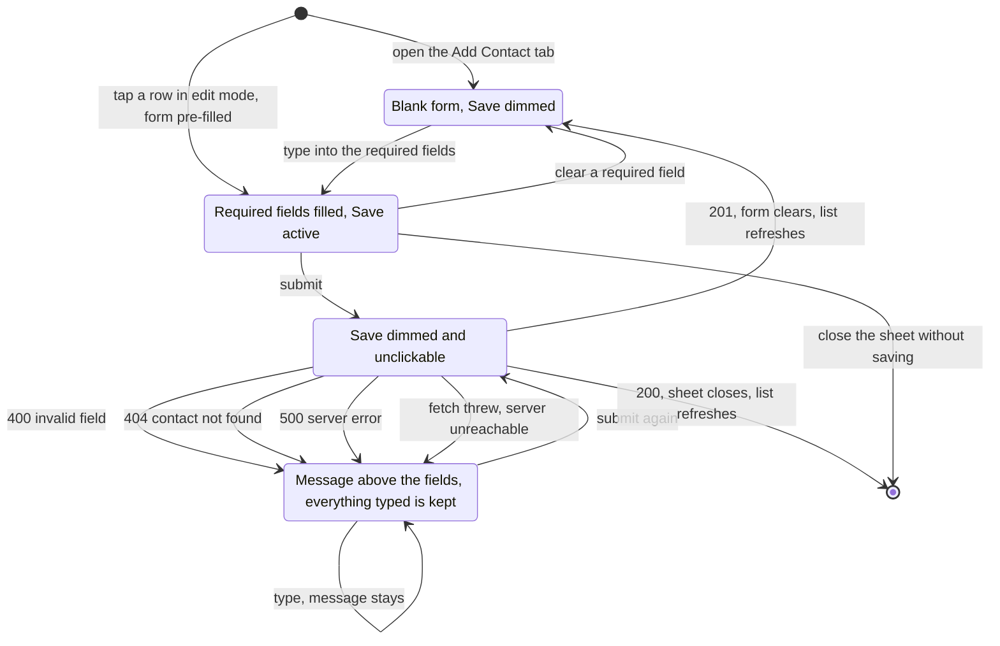

# Emergency contact form

## Why
Users need a way to build and maintain their emergency contact list, so the
people they trust are reachable when they press SOS. The form is the only way
a user manages that list themselves: without it the list stays empty and an
SOS reaches no one. Phone numbers and relationships change, so the same form
edits an existing contact as well as adding a new one.

## Where it lives
- `apps/web/app/contacts/page.tsx` — the `/contacts` screen. A Server
  Component: it reads the user's contacts directly through
  `listEmergencyContacts()` and renders the toggle.
- `apps/web/app/contacts/contacts-toggle.tsx` — owns which tab is showing,
  whether edit mode is on, and which contact is open in the sheet.
- `apps/web/app/contacts/contacts-form.tsx` — the form for one contact, and
  the only component that calls the API from the browser.
- `apps/web/app/contacts/contacts-list.tsx` — the user's contacts, one row
  each. In edit mode a row is tappable.
- `apps/web/app/contacts/contacts-header.tsx` — the title and the Edit button.
- `apps/web/components/bottom-sheet.tsx` — the sliding panel the form opens in
  when editing.
- `packages/domain/src/zod_schemas/contacts.ts` — the field rules below, shared
  by both endpoints.
- The endpoints this screen calls are specified in
  [contact-management.md](../contact-management.md); this spec does not restate
  their contract.

## Behavior
The form adds a new emergency contact or edits an existing one. It carries
first name, last name, phone number, email, relationship, and a
primary-contact toggle. First name, last name, and phone number are required;
the rest are optional.

**Add.** The Add Contact tab shows an empty form. Save posts to
`/api/v1/contacts`. On `201` the fields clear, the screen switches to the
Contacts tab, and the list re-queries and shows the new contact.

**Edit.** The Edit button above the list turns on edit mode: the button reads
"Done" and each row becomes tappable. Tapping a row slides up a bottom sheet
holding the form, pre-filled with that contact. Save sends `PUT` to
`/api/v1/contacts/:id`. On `200` the sheet closes, edit mode ends, and the
row shows the new values. Closing the sheet — its close button, Escape, or
tapping outside — discards any changes.

**While a request is in flight** the Save button is disabled and dimmed, so a
second click cannot send the same contact twice.

**When the server rejects the request**, the message it returned appears above
the fields and everything the user typed is kept. Typing again leaves the
message in place; it clears only when the form is submitted again. Only the
first failing rule is reported, so a form with two bad fields is corrected one
message at a time.

**When the request never reaches a server** — the app is offline or the server
is down — the form shows "Could not reach the server. Check your connection
and try again." and returns to an editable state. It does not stay stuck on
the in-flight state.

Validation runs on the server; the form sends what the user typed and
reports what comes back. The one exception is the required-field check that
keeps Save disabled, which is a convenience, not the rule itself.

| Field | Rule | Error when |
|---|---|---|
| First name | required, 1–30 characters after trimming | empty, only spaces, or over 30 characters |
| Last name | required, 1–30 characters after trimming | empty, only spaces, or over 30 characters |
| Phone number | required; 10 digits, or 11 when the first is `1`, after every non-digit is stripped; 20 characters maximum | any other number of digits, letters, or over 20 characters |
| Email | optional; a valid email address when filled in | filled in and not a valid email address |
| Relationship | optional; one of Parent, Spouse, Sibling, Friend, Other | never: the dropdown offers only these values, and an unselected dropdown is sent as absent |
| Primary contact | optional; defaults to off | never |

Punctuation in a phone number is accepted and stored as the user typed it:
`(561) 309-3489`, `561-309-3489`, and `5613093489` are all valid and all
stored differently.

## UI states
The form holds one `status` at a time — `idle`, `saving`, or `error` — plus
the message that goes with an error. `empty` and `ready` are not stored; they
are the same `idle` status, told apart by whether the required fields have
content.

The API also answers `401`, but the dev identity stub always resolves a user
outside production, so no signed-out state is reachable from this screen and
none is drawn. It arrives with real auth — see [auth.md](../auth.md).

## Examples

| State / input | Behavior |
|---|---|
| Add tab, all required fields valid, Save | `201`; fields clear, Contacts tab shows the new contact |
| Blank form | Save is disabled; no request is sent |
| Phone `123` | `400`; "Enter a 10-digit US phone number." above the fields, typed values kept |
| Phone `+1 (555) 000-0099` | `201`; 11 digits with a leading `1` is a US number |
| Phone `+44 555 000 0099` | `400`; only US numbers are accepted |
| First name of 31 characters | `400`; "First name must be 30 characters or fewer." |
| Email left blank | `201`; email is optional and stored as empty |
| Email `not-an-address` | `400`; "Enter a valid email address." |
| Relationship left on "Select" | `201`; the field is sent as absent, not as an empty string |
| Edit mode, change a field, Save | `200`; sheet closes, edit mode ends, row shows the new values |
| Edit a contact deleted from another window, Save | `404`; "Contact not found." above the fields, sheet stays open |
| Primary toggled on while another contact is primary | `201`; the previous primary is cleared in the same transaction |
| Save with the server stopped | The connection message appears and Save becomes usable again |
| A user with no contacts | The list reads "No contacts yet" and points at the Add Contact tab |

## Verify
- `pnpm test` and `pnpm typecheck` pass.
- With `pnpm dev` running and `pnpm db:seed` applied, every arrow in **UI
  states** can be ridden in the browser. Each one is a click, not an
  inspection.
- The two unhappy paths that need staging:
  - **404** — open a contact in the edit sheet, delete that row in Prisma
    Studio, then Save.
  - **server unreachable** — stop `pnpm dev` with the form filled in, then
    Save. The button must become usable again and the message must appear;
    a button that stays dimmed is the defect this drill exists to catch.
- `curl -s -X POST localhost:3000/api/v1/contacts -H 'Content-Type:
  application/json' -d '{"firstName":"A","lastName":"B","phoneNumber":"123"}'`
  returns `400` with `{ error: { code, message } }`.

## Constraints & decisions
- **One `status`, not a pair of booleans.** The in-flight and error states are
  values of a single variable, so "saving while showing an error" is
  unwritable rather than merely avoided.
- **Nothing derivable is stored.** Whether Save is disabled, whether the sheet
  is open, and which tab is active are all computed from existing state at
  render time, so no two values can disagree about the same fact.
- **The form remounts per contact.** The edit sheet renders the form with
  `key={contact.id}`, because `useState` reads its initial value only on first
  render; without the key, opening a second contact would show the first
  one's values.
- **US numbers only, stored as typed.** The rule counts digits rather than
  characters, so formatting is the user's choice. Numbers are not normalized
  to a canonical form and not verified as reachable. Dedupe and delivery need
  both, and neither exists yet.
- **One message at a time.** The server reports the first failing rule only.
  A form with several bad fields is corrected across several submissions.
- **No optimistic update.** The list changes only after the server confirms.
  The contact list is the thing an emergency depends on, so a row that appears
  before it is saved would be a lie worth avoiding.

## Out of scope
- **Deleting a contact.** `DELETE /api/v1/contacts/:id` exists and is
  specified in [contact-management.md](../contact-management.md), but no
  delete control is built into the list yet.
- **Signed-out access.** No screen state exists for `401`; see
  [auth.md](../auth.md).
- **Phone normalization and verification**, and the SMS delivery that would
  need them. No spec owns this yet.
- **Searching, sorting, or paginating the list.** Contacts come back primary
  first, then by last name, and the whole list is rendered.
